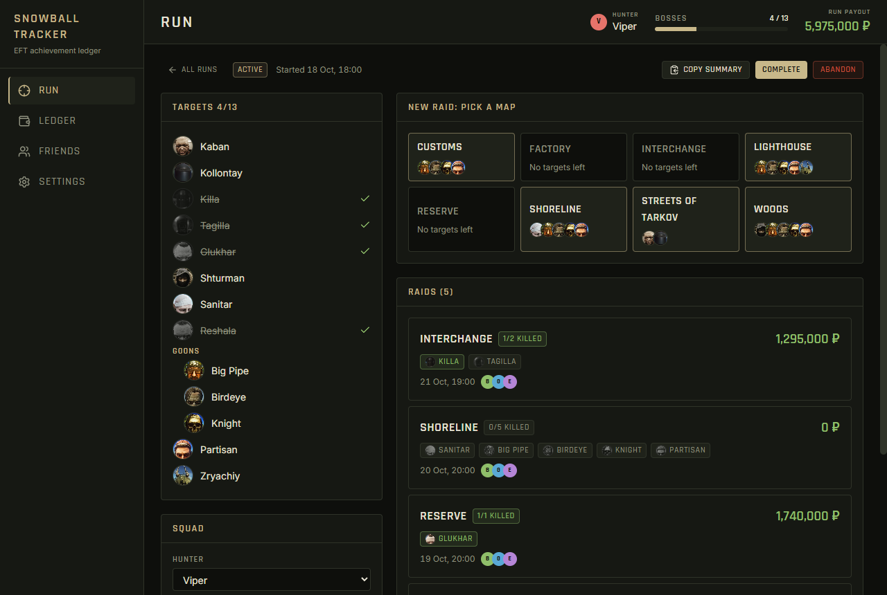
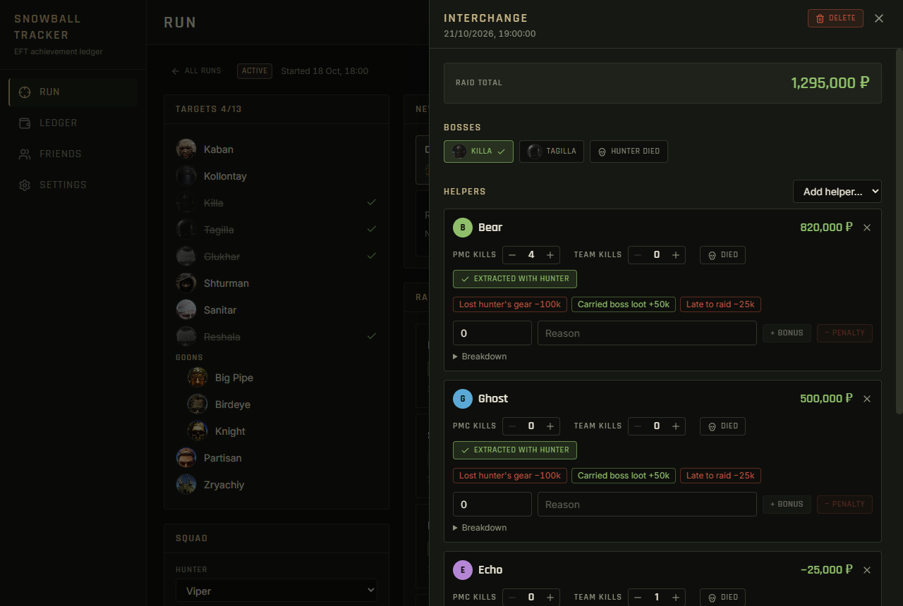
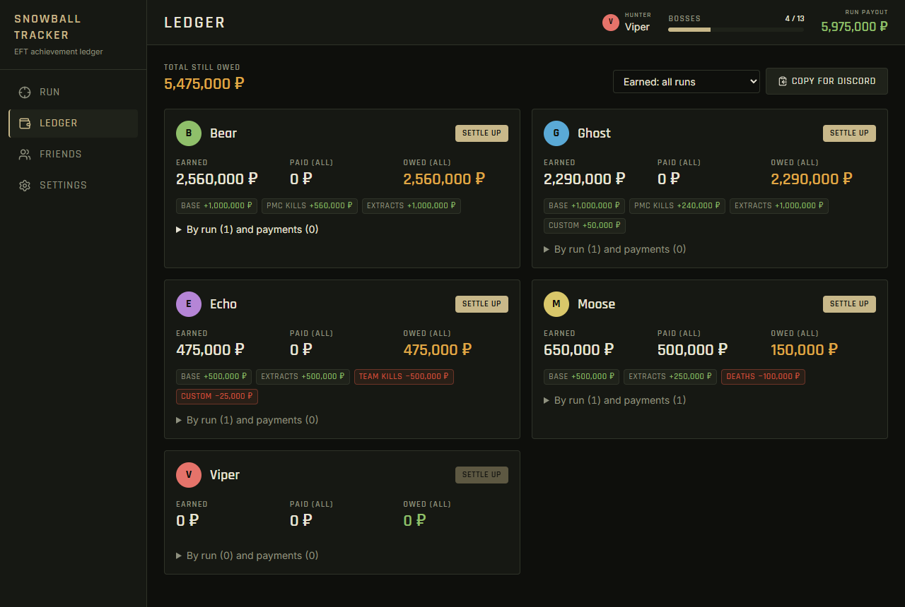

# Snowball Tracker

A desktop app for squads helping one friend through the **Escape from Tarkov "Snowball" achievement**. Log every raid, tick off the bosses, and keep an honest ledger of what each helper is owed in roubles.



## Features

- **Runs and the hunter.** Each attempt is a run with one hunter (the player going for the achievement) and a squad of helpers. A checklist shows which bosses are dead and which are left.
- **Map picker.** Shows the target bosses still alive on each map. Click a map to log a raid there.
- **Raid editor.** Mark bosses killed, then set each helper's PMC kills, team kills, death and "extracted with hunter". Add one-click bonuses or penalties, or a custom amount with a reason. Every helper gets a line-by-line breakdown of their pay.
- **Hunter death ends the run.** Marking "Hunter died" closes the run as failed, because Snowball progress resets.
- **Ledger.** Earned, paid and still owed for each friend across all runs. "Settle up" records a payment, and payments can be undone.
- **Copy for Discord.** One click copies a run summary or the payout list as text.
- **Offline and local.** Data is a single JSON file on your machine. Settings has export and import for backups.

| Raid editor                              | Ledger                                |
| ---------------------------------------- | ------------------------------------- |
|  |  |

## How payouts work

All amounts are set in **Settings → Rates**. Each new raid copies the current rates, so changing them later never rewrites past raids. Per helper, per raid:

| Rule                | Effect                                                                    |
| ------------------- | ------------------------------------------------------------------------- |
| Base per boss       | Paid for every boss killed in the raid                                    |
| PMC kill            | Paid per enemy PMC the helper kills                                       |
| Extract with hunter | Paid when the helper extracts together with the hunter                    |
| Helper death        | Deducted when the helper dies                                             |
| Team kill           | Deducted per friendly kill                                                |
| Hunter death        | Deducted from every helper. It also ends the run.                         |
| Completion bonus    | Paid to every helper once the run is completed with all targets dead      |
| Quick adjustments   | Your own presets, such as "Lost hunter's gear −100k", plus custom amounts |

Bosses killed in the raid where the hunter died don't count toward the achievement. Which bosses count at all is set in **Settings → Achievement targets**.

## Download

Grab the latest Windows installer from [Releases](https://github.com/Ranzz02/snowball-tracker/releases). The installer isn't code-signed, so Windows SmartScreen may warn you the first time you run it.

Your data lives in `%APPDATA%\snowball-tracker\data\app-data.json`. Settings has a button to open that folder.

## Development

You need Node.js 22.12 or newer. Yarn 4 comes with Node's Corepack.

```sh
corepack enable
yarn install
yarn dev        # app with hot reload
yarn test       # unit tests (Vitest)
yarn lint       # ESLint
yarn format     # Prettier
yarn build      # typecheck, bundle and build the installer into release/
```

Built with Electron, React 19, TypeScript, Zustand, Tailwind CSS 4 and Vite. See [CONTRIBUTING.md](CONTRIBUTING.md) for the project layout and how to send changes.

## Disclaimer

This is a fan-made tool and is not affiliated with or endorsed by Battlestate Games. Escape from Tarkov, its boss names and the boss portraits in `public/bosses/` are the property of Battlestate Games Limited and are used here only for identification.

## License

[MIT](LICENSE). This covers the source code only, not the game assets mentioned above.
